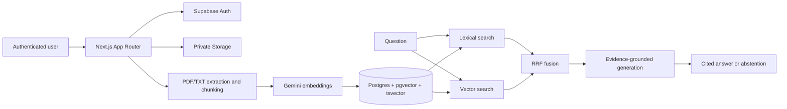
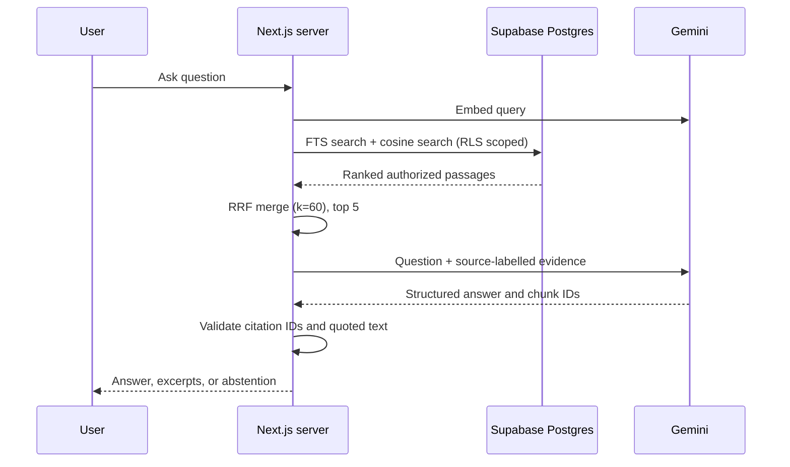

# MediQuery AI

Evidence-grounded medical document intelligence for understanding information explicitly stated in a user's own reports. This project demonstrates authenticated ingestion, page-aware chunking, hybrid lexical/semantic retrieval, Reciprocal Rank Fusion, and answers with source citations. It is **not** a clinical decision support system and must not be used for diagnosis or treatment.

## Status

This repository has an implemented application foundation and MVP workflows. A fully configured end-to-end run requires a Supabase project and Gemini API key. The application has not been deployed. No real patient data or API credentials belong in this repository.

## Architecture



## Hybrid retrieval



## Stack

Next.js App Router, strict TypeScript, Tailwind CSS, Supabase Auth/Postgres/Storage and RLS, pgvector, PostgreSQL full-text search, Gemini embeddings and configurable chat model, Zod, Vitest, ESLint, and GitHub Actions.

## Prerequisites and local setup

- Node.js 20.9+ (Node 22 recommended) and npm.
- Supabase project with the `vector` extension available.
- Gemini API key with access to configured embedding and chat models.

```bash
npm install
cp .env.example .env.local
# Fill the variables below.
npm run dev
```

Visit `http://localhost:3000`. Configure Supabase Auth email settings and redirect URL for `http://localhost:3000/**`. If email confirmation is enabled, confirm before signing in.

### Environment variables

| Variable | Required | Purpose |
|---|---:|---|
| `NEXT_PUBLIC_SUPABASE_URL` | yes | Supabase project URL |
| `NEXT_PUBLIC_SUPABASE_ANON_KEY` | yes | Browser-safe anon key; access remains subject to RLS |
| `SUPABASE_SERVICE_ROLE_KEY` | uploads/deletion | Server-only privileged operations; never expose to client |
| `GEMINI_API_KEY` | processing/Q&A | Server-only Gemini credential |
| `GEMINI_CHAT_MODEL` | no | Answer model, defaults to `gemini-3.5-flash-lite` |
| `GEMINI_EMBEDDING_MODEL` | no | Defaults to `gemini-embedding-2` (1536 dimensions) |
| `MAX_UPLOAD_MB` | no | Upload size cap, at most 10 MB |
| `CHUNK_SIZE`, `CHUNK_OVERLAP` | no | Character-based chunk sizing |
| `RRF_K` | no | RRF smoothing constant, default 60 |
| `RETRIEVAL_CANDIDATES`, `RETRIEVAL_TOP_K` | no | Candidate/final retrieval counts |
| `APP_URL` | no | Public app URL for deployment configuration |

Copy `.env.example` to `.env.local`, then create a Gemini API key in Google AI Studio and add it to `GEMINI_API_KEY`. Never commit `.env.local`.

## Database setup

Apply `supabase/migrations/0001_initial.sql` using Supabase CLI:

```bash
npx supabase login
npx supabase link --project-ref YOUR_PROJECT_REF
npx supabase db push
```

The migration creates profiles, documents, chunks, conversations, messages, search functions, RLS policies, indexes, and a private `medical-reports` bucket with per-user storage policies. Confirm the Supabase project supports pgvector/HNSW. Gemini embeddings use 1536 dimensions. Documents embedded with a different provider must be deleted and uploaded again so all vectors use the same model space.

## Synthetic demo data

`data/evaluation-v1.json` contains fabricated evaluation excerpts. For upload demos, create a `.txt` report marked `SYNTHETIC DEMONSTRATION` with invented values. Do not use real reports unless you understand the privacy and retention implications of your deployment.

## Evaluation

```bash
npm run eval
npm test
```

The offline runner reports Recall@5 and MRR@5 over four synthetic questions. `semantic-token-baseline` uses token overlap as a deterministic stand-in; it is not Gemini vectors or production pgvector search. Live retrieval has separate lexical and vector RPCs with RRF, but benchmark integration against a deployed database is not configured here. Faithfulness/relevance judge scores need a separately configured evaluator and are currently unscored. Neither the small dataset nor any automated score is clinical validation.

## Checks

```bash
npm run lint
npm run typecheck
npm test
npm run build
```

GitHub Actions runs lint, typecheck, and unit tests. Playwright is a development dependency; an E2E suite still needs an isolated seeded Supabase project and secrets.

## Deployment (Vercel + Supabase)

1. Create a Supabase project and apply the migration.
2. Configure Auth site URL and allowed redirects for the Vercel domain.
3. Import the repository into Vercel as a Next.js app.
4. Set the variables from `.env.example` in Vercel settings. Keep server secrets private.
5. Deploy, then verify signup, confirmation, upload, deletion, retrieval, and abstention with synthetic documents.

`vercel.json` declares the Next.js framework. Service-role operations happen only after server-side authentication and explicit `user_id` scoping. Review access policies and retention requirements before handling sensitive documents.

## API

| Method | Route | Purpose |
|---|---|---|
| `GET` | `/api/documents` | List the signed-in user's documents |
| `POST` | `/api/documents/upload` | Validate, store, extract, chunk, embed, and index PDF/TXT |
| `DELETE` | `/api/documents/:id` | Delete the user's object and cascading document data |
| `POST` | `/api/ask` | Hybrid RAG; body `{ "question": "...", "documentIds": [] }` |

## Security and limitations

- RLS isolates user rows; privileged route operations authenticate and scope by `user_id`.
- Storage is private and paths start with the authenticated UUID and a random document UUID.
- Extension, MIME, size, PDF signature, and UTF-8 are validated. Scanned PDFs need OCR, not configured here.
- Report text is not written to application logs. Gemini Free Tier data may be used to improve Google products. Use only synthetic or de-identified reports and review Google current terms before processing sensitive documents.
- RRF avoids mixing uncalibrated lexical and vector scores. Abstention is model-led unless retrieval is empty; this heuristic needs stronger evaluation.
- No clinical validation, accuracy claim, external security audit, production deployment, or E2E run is claimed.

## Roadmap

- Persist conversation grouping and expose question history.
- Add private live retrieval benchmarks and configurable answer evaluation.
- Add Playwright flows backed by an isolated test project.
- Add robust PDF parser limits, retry/reprocessing controls, and optional OCR.
- Add safe-metadata observability and retention/deletion export controls.

## Publish to GitHub

After reviewing secrets and generated files:

```bash
git init -b main
git add .
git status --short
git commit -m "Build MediQuery evidence-grounded document intelligence MVP"
git remote add origin https://github.com/YOUR_ACCOUNT/mediquery-ai.git
git push -u origin main
```


